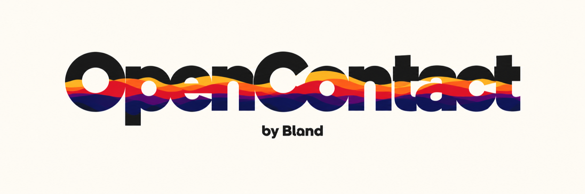
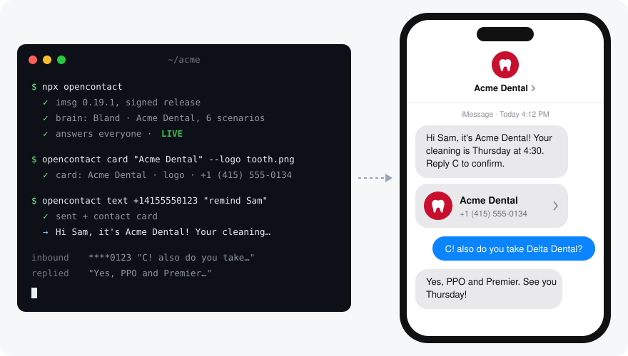

<p align="center">
  
</p>

<p align="center">
  <strong>Your business's AI agent, on the number your customers already text.</strong><br>
  It answers, it reaches out, and it puts you in their Contacts. One command on a Mac.
</p>

<p align="center">
  <a href="https://github.com/CINTELLILABS/opencontact/actions/workflows/ci.yml"></a>
  <a href="https://www.npmjs.com/package/opencontact"></a>
  
  
  <a href="LICENSE"></a>
</p>

<p align="center">
  <a href="#quick-start">Quick start</a> ·
  <a href="#the-agent">The agent</a> ·
  <a href="#from-your-coding-agent">Skills</a> ·
  <a href="#commands">Commands</a> ·
  <a href="#built-to-be-trusted-with-your-number">Safety</a> ·
  <a href="#bring-your-own-model">Your own model</a>
</p>

<p align="center">
  
</p>

```sh
npx opencontact
```

Run it on the Mac signed into your business's iMessage. Give it your website and [Bland](https://bland.ai) writes
the agent: your hours, services, prices, booking links, and when to hand off to a person. From then on, people who
text your number get a real answer, from the number they already have saved.

No new number. No carrier forms. No server.

## What it does

- **Answers every text.** Questions, bookings, reschedules, "are you open Sunday?", from your own line, whenever
  the Mac is on.
- **Reaches out first.** `opencontact text +1… "remind Sam about Thursday"` and the agent writes and sends the
  message, then handles the reply.
- **Puts you in their Contacts.** With its first message the agent sends your contact card: your name, logo, and
  number. One tap and every text after that says "Acme Dental", not a number nobody recognizes. No other open
  source tool does this.
- **You can step in anytime.** Every conversation sits in one window. Open one, type, and your message goes out
  from your number while the agent steps aside; press **A** to hand it back. Replying from the Messages app works
  too. Caps, an audit log, and an outreach mode that never talks to strangers keep it safe on a real line.

## Quick start

**Answer your business line.**

```sh
npx opencontact acme-dental.com
opencontact run --live
```

The agent, the contact card and its logo all come from the website. Change the card any time with
`opencontact card "Acme Dental" --logo logo.png`.

**Remind everyone on a list.** Each person gets their own message, the replies come back in parallel, and the
agent only talks to people it texted first.

```sh
opencontact answer outbound
opencontact text --list patients.csv "remind them about this week's appointment"
```

`patients.csv` is any spreadsheet export with a phone column. Names and other columns (appointment time,
provider) go to the agent as details for that person. Keep `opencontact run` open in another tab to watch the
replies roll in.

Setup installs [`imsg`](https://github.com/openclaw/imsg) from its signed release, walks you through the two
macOS permissions, and starts. You need macOS 14 or later, Node 24 or later, and a Bland API key: free, no card, from
[app.bland.ai](https://app.bland.ai/dashboard/settings). From a coding agent, the skills can sign you up inside the chat.

## The agent

The agent is a [Bland](https://bland.ai) agent, built from your website in about a minute:

- **It reasons.** Not a script of canned replies. It reads your site live, follows the scenarios it wrote for your
  business, and asks for what it needs before it acts.
- **It remembers each customer.** Who they are and what they asked before, across every conversation.
- **It knows when to stop.** Handoff rules send a conversation to you when it should, and you see every exchange
  in the Bland dashboard.
- **It grows with you.** The same agent can answer calls, and move to its own number with your logo and a
  verified badge on Android when you outgrow the Mac.

Change it in plain words from the dashboard or your coding agent: "make it shorter", "never quote prices",
"hand off when someone says cancel".

## From your coding agent

Already in Claude Code, Codex, Cursor, OpenClaw, or another harness that reads skills?

```sh
npx skills add CINTELLILABS/opencontact
```

> Build an agent for acme-dental.com and run it on this Mac's iMessage. Only answer my number for now.

The harness runs the same setup from inside the conversation and keeps editing the agent afterwards: "make it
shorter", "never quote prices", "hand off when someone says cancel". Claude Code users can also
`/plugin marketplace add CINTELLILABS/opencontact`.

| Skill                      | Teaches the harness to                                                         |
| -------------------------- | ------------------------------------------------------------------------------ |
| `opencontact-build-agent`  | sign up for Bland from inside the chat, build an agent from a website, test it, edit it |
| `opencontact-run`          | install and run opencontact: setup, permissions, dry-run, go live, keep it running |
| `opencontact-phone-number` | move the agent to its own number with SMS, RCS branding, voice, and iMessage   |

## Commands

| Command                                   | What it does                                                          |
| ----------------------------------------- | --------------------------------------------------------------------- |
| `opencontact`                             | First run: guided setup. After that: same as `run`.                   |
| `opencontact <website>`                   | Build that business's agent from its site, with a card carrying its name and logo, and go live. |
| `opencontact run [--live]`                | The live view: every conversation in a sidebar, the open one as chat bubbles. **↑↓** switch, **Enter** write as yourself, **A** hand back to the agent, **F** follow the latest, **L**/**D** live or dry-run, **Q** quit. |
| `opencontact text <number> "why"`         | The agent reaches out first, then sends your card. `--name Kyle` so it greets the right person. |
| `opencontact text --list people.csv "why"` | Reach out to a whole list. Names and any other columns become details for each message. |
| `opencontact answer everyone\|outbound`   | Answer anyone, or only people the agent texted first.                 |
| `opencontact only <number…>`              | Answer only these numbers, for testing on a personal line.            |
| `opencontact brain <name>`                | Switch who answers.                                                   |
| `opencontact card "Name" --logo logo.png` | Set the contact card. A changed card is sent again on each contact's next reply.      |
| `opencontact status`                      | Brain, who it answers, live or dry-run, card, caps.                   |
| `opencontact log`                         | The last decisions: what came in, what went out, what was skipped and why. |
| `opencontact doctor`                      | Checks imsg, permissions, keys, config. Paste it into bug reports.    |
| `opencontact stop`                        | Stop the running agent. Only one runs per Mac.                        |
| `opencontact forget <number>`             | Start a contact over: a new conversation, and the card goes again. For rehearsing. |
| `opencontact setup`                       | Run setup again. Flags for scripts: `--brain`, `--website`, `--agent`, `--answer`, `--only`, `--live`, `--yes`. |

Requirements: macOS 14 or later, Node 24 or later. macOS asks for Full Disk Access and Automation → Messages for
your terminal; `opencontact` tells you where to click.

## Built to be trusted with your number

- **Dry-run by default** in scripts, and one keypress away in a live run.
- **Owner takeover.** You reply, it steps back.
- **Caps.** 60 replies an hour overall and 20 per contact, so a loop between two bots stops fast.
- **No double replies.** Every reply is keyed to the message that caused it. A restart resumes where it left off and
  never answers a backlog.
- **No private APIs.** Only the Full Disk Access and Automation permissions you grant. Nothing asks you to
  disable System Integrity Protection.
- **Verified install.** `imsg` comes from its signed GitHub release, checked against the published SHA-256 and the
  author's Developer ID before it runs.
- **Your data stays put.** Keys in a `0600` config, redacted from every log. Message text goes only to the brain you
  chose, and nothing goes anywhere for messages it does not answer. Phone numbers in the audit log are masked.

Details in [docs/safety.md](docs/safety.md).

## Honest limits

- **One Mac, awake and signed into Messages.** For a line that runs without a Mac, see below.
- **Text out, plus the contact card.** The agent cannot send photos or link previews from your line.
- **Replies take as long as the brain thinks.** A Bland agent reading your website live takes 10 to 20 seconds; a
  persona on a fast model takes a few. Lower the agent's reasoning effort if speed matters more.
- **Apple does not document automating Messages.** Every tool in this space works the same way, and nothing here
  is new to it. Still, run a business on a dedicated Apple ID or number, not your personal one.

## When you outgrow the Mac

A [Bland](https://bland.ai) number runs the same agent with no Mac: your name, logo, and verified badge on
Android through RCS, photos and link previews, iMessage effects through Bland's partner, and calls on the same
number. The `opencontact-phone-number` skill makes the switch, and the agent and its memory come with it.

## Bring your own model

Want a persona on your own number instead of a business agent? opencontact runs with other brains too, as a free
on-ramp. They get a persona you write in `~/.config/opencontact/persona.md` and memory of each thread, but not
the business features above. Switch any time with `opencontact brain <name>`.

| Brain         | What answers                                                         | Web                        | Photos people send    | Needs                    |
| ------------- | -------------------------------------------------------------------- | -------------------------- | --------------------- | ------------------------ |
| `bland`       | A business agent built from your website: scenarios, handoff, memory per customer, a dashboard | browses your site live     | told one arrived      | a Bland key, free        |
| `claude-code` | `claude -p` with your existing Claude login                          | WebSearch, WebFetch        | opens them with Read  | Claude Code              |
| `codex`       | `codex exec` with your existing ChatGPT login, read-only sandbox     | per your Codex config      | paths passed          | Codex CLI                |
| `anthropic`   | Claude over the API, adaptive thinking                               | server-side web search     | yes, as image blocks  | an Anthropic key         |
| `openai`      | OpenAI or any OpenAI-compatible server (LM Studio, vLLM)             | no                         | yes, vision models    | a key, or none locally   |
| `ollama`      | A local model, auto-detected, picked from what you pulled            | no                         | multimodal models     | Ollama running           |
| `command`     | Any program: prompt on stdin, reply on stdout                        | up to you                  | paths in the prompt   | the program              |

```sh
opencontact brain claude-code --name "Raj"   # your existing Claude login
opencontact answer everyone
opencontact run --live
```

`claude-code` and `codex` run the official CLIs with the login already on your Mac; opencontact never reads a token.
Whether your plan covers that is the vendor's policy, and an API key always works.

## How it works

```
Messages.app ⇄ imsg rpc ⇄ opencontact ⇄ the brain (Bland, Claude Code, Codex, your model)
```

`opencontact` watches new rows in the Messages database through `imsg`, decides whether to answer (answer mode,
owner takeover, caps, duplicates), hands the text and any photos to the brain, and sends the reply back into the
same chat. About 4,000 lines of TypeScript with no runtime dependencies. Start with
[docs/architecture.md](docs/architecture.md); the Bland endpoints it calls are in [docs/bland-api.md](docs/bland-api.md).

## Contributing

```sh
git clone https://github.com/CINTELLILABS/opencontact && cd opencontact
corepack enable && pnpm install --frozen-lockfile
pnpm check
```

See [CONTRIBUTING.md](CONTRIBUTING.md). Recording a demo? [docs/demo-script.md](docs/demo-script.md) is a
90-second take.


## License

[MIT](LICENSE) © Bland AI, Inc.
